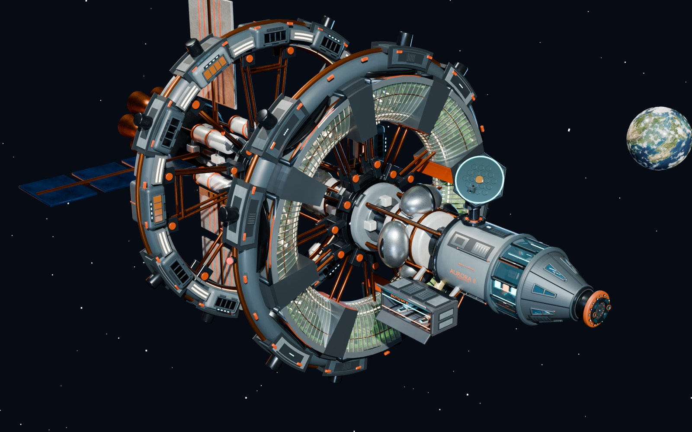
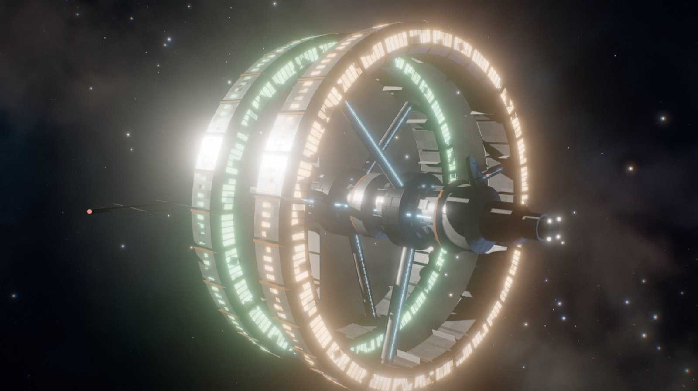
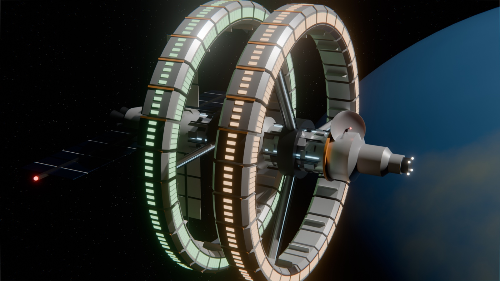
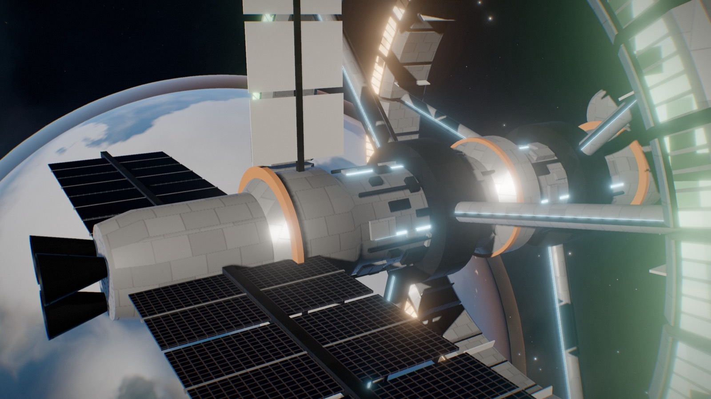
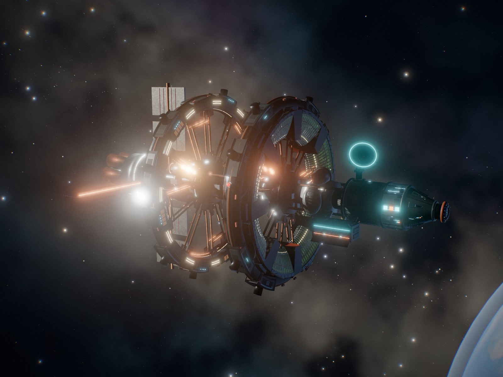

# blender-web-3d — a Claude Code skill

Build, modify, and render 3D models with **headless Blender scripting**, then
publish them online as an **interactive Three.js/Next.js web app** — driven
entirely by [Claude Code](https://claude.com/claude-code).



This skill was extracted from a real shipped project: a ~2 km colony ship
modelled through ~30 versioned Blender scripts, exported to an 11 MB
Draco+WebP GLB, and deployed as a live orbit-viewer on Vercel — every step
performed by Claude without opening the Blender GUI. The skill captures the
patterns that worked and, just as importantly, the failures that cost real
debugging time.

## v2 — from "okay" to stunning

Version 2 folds in everything learned since: Aurora v028–v033 (runtime batching,
adaptive quality, HDR lightmaps) and a fresh end-to-end build of a demo model. It now
ships **runnable assets**, not just notes. A procedural station is modelled headless in
Blender 5.2, exported, optimised to 332 KB, and rendered live with custom shaders:



| Cycles beauty render (1 m 45 s, Metal) | Same model, real-time in the viewer |
|---|---|
|  |  |

Everything in the backdrop is procedural GLSL with no textures shipped: nebula sky baked to a
cubemap and reused as image-based lighting, twinkling stars, and a planet with clouds,
ocean glint, city lights and an atmosphere. Hull plating, living windows and
iridescent solar cells are **material patches** keyed on Blender material names.

The same template runs the 10 MB Aurora GLB unmodified. It finds the ring pivots,
patches materials, and batches 2,091 → 330 meshes:



## What's inside

```
plugins/blender-web-3d/skills/blender-web-3d/
├── SKILL.md                        # workflow, quality bar, design lessons
├── references/
│   ├── blender-scripting.md        # managed scripts, Blender 5.x API table, bmesh,
│   │                               # BVH cleanup, draw-call consolidation, renders
│   ├── export-pipeline.md          # raw export + gltf-transform, silent-breakage traps
│   ├── lookdev-and-shaders.md      # quality bar, AgX both sides, shader patch rules
│   ├── performance.md              # batching, meshopt/KTX2, adaptive tiers, numbers
│   ├── threejs-viewer.md           # template architecture, NaN-scrub, hidden-pane QA
│   └── baked-lighting.md           # Cycles lightmaps -> RGBE HDR -> lightMap on UV2
└── assets/
    ├── blender/                    # demo_station.py, render_beauty.py, export_glb.py
    └── viewer/                     # Vite + three r186 template + optimize-glb.mjs
```

Highlights — things you'd otherwise learn the hard way:

- **Names are the contract** between Blender and the viewer: `*_Pivot*` spins,
  `Hull*` gets procedural plating, `Window_*` gets per-room occupancy and flicker,
  `Beacon_Red/Green` strobe like aircraft nav lights.
- **The quantized-geometry trap**: meshopt stores positions as normalized Int16, so
  object-space shader detail sized in metres silently covers the whole mesh, and
  `applyMatrix4` on the raw arrays truncates geometry. Both are fixed in the template.
- **gltf-transform `flatten()` + `prune()` delete JS-driven pivots**, so rotating rings stop
  without an error. `palette()` erases the material names your shaders key on.
- **Per-light shadow flag**: with `shadow.autoUpdate = false`,
  `renderer.shadowMap.needsUpdate` does nothing, and the whole model vanishes
  while draw-call counts look normal.
- **The NaN-scrub pass** before bloom, the **occluded-window trap** (hidden pages get
  no rAF and a zero `Timer` delta), and a **hidden-pane frame-capture** loop so an
  agent can QA real pixels.
- **Adaptive quality** with asymmetric hysteresis, runtime **static batching** that
  respects animated ancestors, `compileAsync` before reveal, half-res bloom, and
  shadow maps refreshed on demand.
- **Blender 5.x API changes** (EEVEE id, node-group compositor, glare sockets,
  `set_sharp_from_angle`), headless Cycles beauty rig with AgX + compositor bloom.
- Still here from v1: managed-script pattern, BVH orphan cleanup, animation-safe
  draw-call consolidation, glTF export gotchas, MCP-vs-CLI guide.


## Install

**As a Claude Code plugin (recommended):**

```
/plugin marketplace add czlonkowski/blender-web-3d-skill
/plugin install blender-web-3d@blender-web-3d
```

**Or copy the skill folder directly** (works with any
[Agent Skills](https://agentskills.io)-compatible client):

```bash
git clone https://github.com/czlonkowski/blender-web-3d-skill.git
cp -r blender-web-3d-skill/plugins/blender-web-3d/skills/blender-web-3d ~/.claude/skills/
```

Either way it triggers on requests like "improve the model", "render this in
Blender", "make a 3D web demo", "export to GLB", or "the model looks wrong in
the browser".

The skill follows the open [Agent Skills specification](https://agentskills.io/specification)
(frontmatter-validated; SKILL.md under 500 lines with progressive-disclosure
references).

Requirements: Blender on PATH (tested with 4.x and 5.2), Node 20+ for the viewer
template (`cd assets/viewer && npm i && npm run dev`),
optionally the [BlenderMCP](https://github.com/ahujasid/blender-mcp) addon for
live-GUI sessions.

## Provenance

Written by [Claude Code](https://claude.com/claude-code) as a distillation of
an AI-driven modelling session, for [AiAdvisors](https://aiadvisors.pl/en).
The renders and browser captures above are unedited output from the pipeline itself.

## License

MIT
